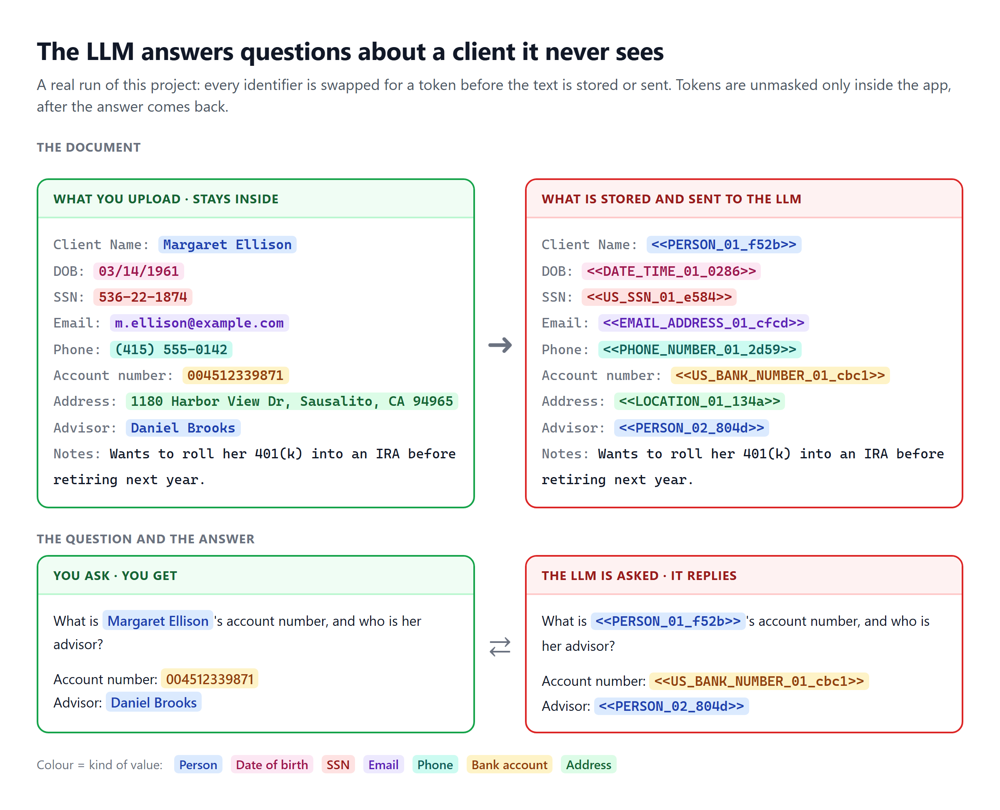
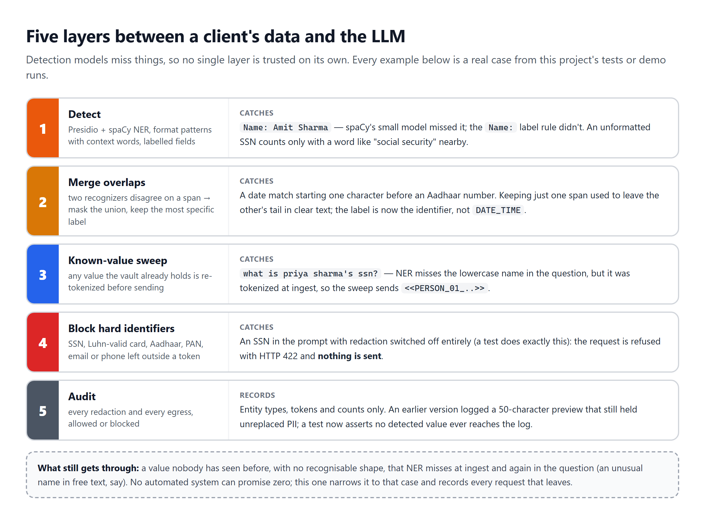
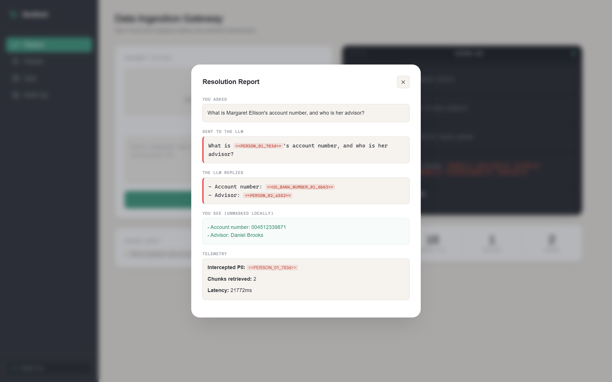
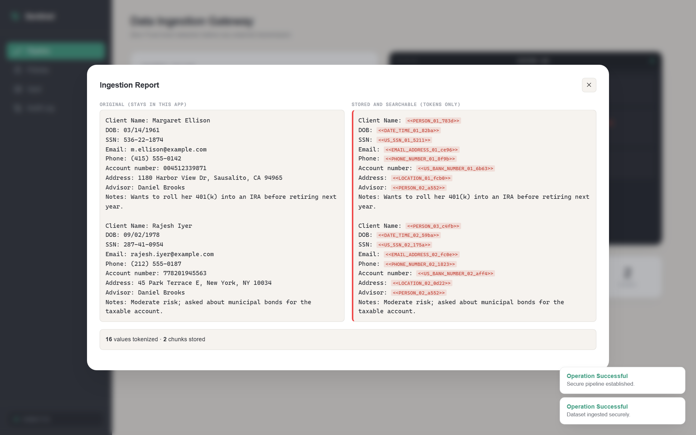
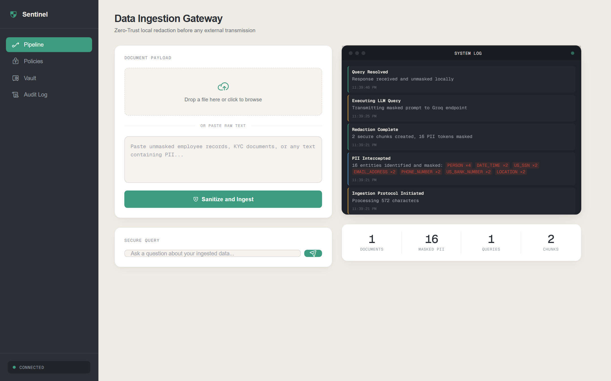
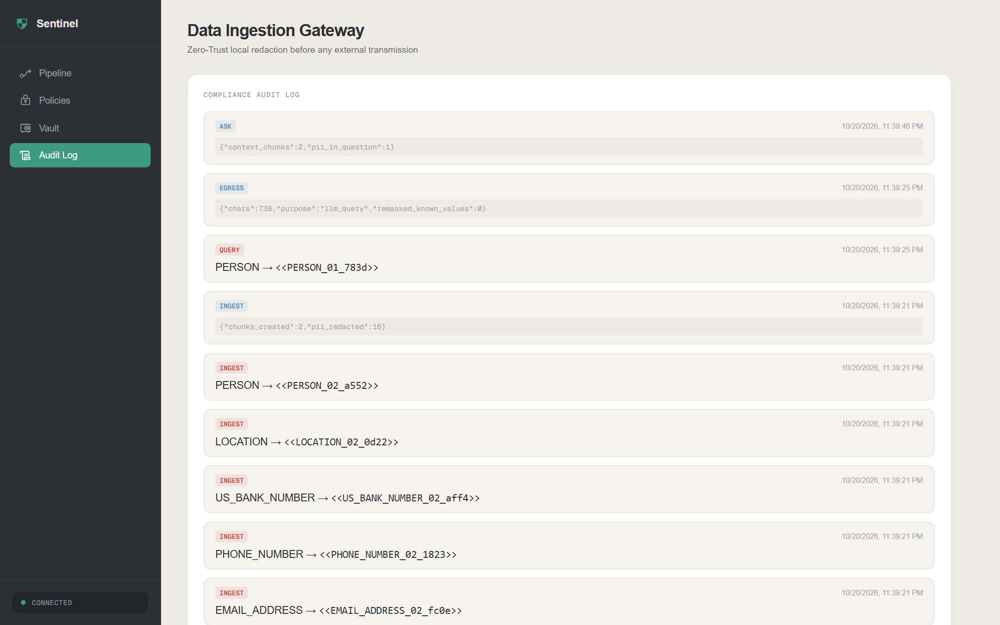

# Zero-Trust PII RAG

Ask an LLM questions about documents full of client data, without the LLM ever seeing the client.

Every name, SSN, account number, address and date of birth is swapped for an opaque token before the
text is stored, embedded or sent anywhere. The LLM reads and answers in tokens; the real values are
put back only inside the app, after the answer returns.

[](https://github.com/abhishek-pandey7/Zero-Trust-PII-RAG/actions/workflows/ci.yml)
&nbsp;**Live demo:** [zero-trust-pii-rag.onrender.com](https://zero-trust-pii-rag.onrender.com) (free tier: the first visit after a quiet spell takes up to a minute to wake)



## Why

Firms that hold client data (brokerages, banks, insurers, HR) want LLMs to answer questions over their
records, but sending a client's SSN or account number to a third-party model provider is exactly what
privacy rules like GLBA, GDPR and India's DPDP Act are written to stop. Masking with `[REDACTED]`
doesn't work either: the model can no longer tell one client from another, so it can't answer.

This project keeps the meaning and removes the identity. `Margaret Ellison` becomes
`<<PERSON_01_f52b>>` everywhere it appears, in every document and every question, so the LLM can still
reason ("the advisor for `<<PERSON_01_f52b>>` is `<<PERSON_02_804d>>`") without knowing who anyone is.

## How it works


- **One way out.** Detection, tokenizing, chunking, embedding (MiniLM on ONNX Runtime) and storage all
  run in-process. The only network call carrying document content is the LLM prompt, and it is made
  of tokens.
- **Deterministic tokens.** The vault maps each value to one token, forever, so retrieval and the
  LLM's reasoning both work across documents.
- **Unmasking is local.** Tokens in the LLM's reply are resolved against the vault in the app. The
  reply is parsed tolerantly, so a token echoed without its angle brackets still resolves.

### Five layers, because detection models miss things



The egress guard is the important one. It runs on the exact text about to be sent: any value the vault
already knows is re-tokenized, and anything still shaped like an SSN, card number, Aadhaar, PAN, email
or phone number blocks the request outright. A test switches redaction off entirely and checks that an
ingested SSN still never reaches the LLM.

## Screenshots

| Ask a question | Ingest a document |
| --- | --- |
|  |  |
| **Pipeline and live log** | **Audit log** |
|  |  |

## What it detects

18 entity types, from Microsoft Presidio's recognizers, spaCy NER and recognizers written for this project:

| Kind | Entity types |
| --- | --- |
| People and places | `PERSON`, `LOCATION`, `NRP` (nationality, religion, politics), `DATE_TIME` (dates with digits only) |
| US financial and government IDs | `US_SSN`, `US_ITIN`, `US_BANK_NUMBER`, `CREDIT_CARD`, `IBAN_CODE`, `US_PASSPORT`, `US_DRIVER_LICENSE` |
| Indian IDs | `IN_AADHAAR`, `IN_PAN`, Indian mobile numbers |
| Contact and network | `EMAIL_ADDRESS`, `PHONE_NUMBER`, `URL`, `IP_ADDRESS`, `MEDICAL_LICENSE` |

Two rules matter more than the list:

- **Labelled fields.** In structured records, a value after `Name:`, `Client:`, `Account Holder:`,
  `Advisor:`, `Address:` or `DOB:` is treated as PII whatever NER thinks. spaCy's small model missed
  `Name: Amit Sharma`; this rule doesn't.
- **Recall first.** When recognizers overlap, the union is masked. A weak pattern (a bare 9-digit
  number) counts when a context word like "social security" is nearby. An unmasked character is a
  leak; an over-masked one only costs some answer quality.

## Measured

| | |
| --- | --- |
| Tests | **81**, run in CI on every pull request |
| Security property under test | no detected value in stored chunks, in the audit log, or in anything sent to the LLM |
| Redaction switched off entirely | the egress guard still blocks the SSN; the LLM is never called |
| Memory | **414 MB peak of 512 MB**, booting the real image and ingesting 100 records under a hard limit (CI job `memory-budget`) |
| Embeddings | computed locally; vectors match ChromaDB's reference implementation to 7e-8 |

## Run it

Needs Python 3.12 and a free [Groq API key](https://console.groq.com/).

```bash
python -m venv venv && venv/bin/activate          # Windows: venv\Scripts\activate
pip install -r requirements-dev.txt
echo "GROQ_API_KEY=your_key" > .env

FLASK_ENV=development python app.py               # http://localhost:5000
python demo.py                                    # command-line walkthrough
pytest                                            # 81 tests
```

The first start downloads the embedding model (90 MB, from Hugging Face) into `./models`. Synthetic data to try:
`python scripts/generate_records.py --count 20`.

With Docker, matching the hosted setup:

```bash
docker build -t zero-trust-rag .
docker run -p 5000:5000 -e GROQ_API_KEY=your_key -m 512m zero-trust-rag
```

## Deploy

`render.yaml` describes the Render service: one gunicorn process with 8 threads, the embedding model
fetched at build time, and `ZT_MAX_INPUT_CHARS=30000` so an oversized upload gets a clear 400 instead of
running a 512 MB instance out of memory. Set `GROQ_API_KEY` in the Render dashboard. `/api/health`
reports the deployed commit and whether the models have loaded.

## API

| Method | Path | Does |
| --- | --- | --- |
| `POST` | `/api/ingest` | `{"data": "..."}`: tokenize, chunk, embed and store text |
| `POST` | `/api/upload` | multipart `file` (.txt, .pdf, .docx): same as ingest |
| `POST` | `/api/ask` | `{"question": "..."}`: returns the answer plus `masked_question` and `masked_answer`, i.e. exactly what crossed the boundary |
| `GET` | `/api/audit` | recent audit events (types, tokens and counts only) |
| `GET` | `/api/policies` | the active model, threshold and entity list |
| `GET` | `/api/stats` | token counts per entity type, chunks stored |
| `GET` | `/api/health` | liveness, model status, deployed commit |

A blocked request returns `422` with the entity types that would have leaked.

## Layout

```
app.py                      Flask API, Socket.IO events, web UI
src/zero_trust_rag/
  pii_redactor.py           detection, labelled fields, overlap merging, tokenizing
  vault.py                  value <-> token store (SQLite), tolerant unmasking
  egress.py                 known-value sweep and hard-identifier block before the LLM
  embeddings.py             MiniLM on ONNX Runtime, memory-tuned
  pipeline.py               ingest and ask
  llm.py                    Groq client with jittered retries
  splitter.py               chunking that never cuts a token
  audit_logger.py           JSON-lines audit trail
scripts/                    record generator, memory profile, diagram and screenshot renderers
docs/diagrams/              HTML sources for the diagrams above (python scripts/render_diagrams.py)
prep/                       interview notes on the design
```

## Known limitations

- **One shared vault on the demo.** Everyone using the hosted demo shares one vault and one index, and
  the Vault page shows real values without a login. Use synthetic data only. Per-browser workspaces are
  on the `feat/workspace-isolation` branch.
- **Values are stored in plaintext** in the SQLite vault. Encrypting them, with a separate key per
  workspace so erasing a workspace can be done by deleting its key, is next.
- **spaCy's small model** misses some names in free text and sometimes tags all-caps headings as
  places. The labelled-field rule and the egress guard cover the common cases; an unusual name in
  free text that is never labelled anywhere can still get through.
- **Hosted limits.** Render's free tier sleeps when idle, wipes its disk on restart, and accepts up to
  30,000 characters per request.
